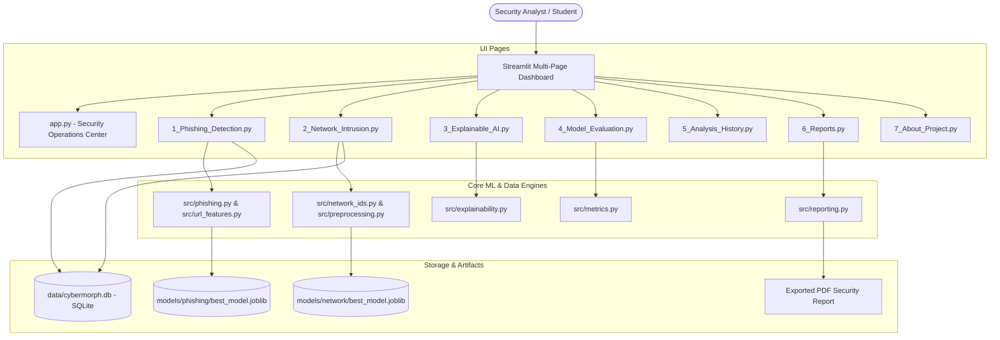

# 🛡️ CyberMorph AI
### Intelligent Cyber Threat Detection & Analytics
> **Official Academic Title:** *“CyberMorph AI: An Explainable Machine Learning-Based Framework for Phishing Detection, Network Intrusion Detection and Cyber Threat Analytics”*

[](https://www.python.org/)
[](https://streamlit.io/)
[](https://scikit-learn.org/)
[](https://docs.pytest.org/)
[](LICENSE)

---

## 📌 1. Project Overview

**CyberMorph AI** is a unified, explainable machine learning cyber threat analytics platform developed for final-year engineering project demonstration and viva evaluation. It combines defensive threat intelligence with transparent artificial intelligence to evaluate two major cybersecurity attack vectors:

1. **Phishing Website Ingestion:** Passive lexical inspection of URLs mapped to the benchmark 30-feature UCI Phishing Websites standard without remote code execution.
2. **Network Intrusion Detection System (NIDS):** High-throughput flow telemetry classification evaluating network packet features against the CIC-IDS2017 flow benchmark.
3. **Explainable AI (XAI):** Global feature importances and local diagnostic signals preventing black-box opacity.
4. **Audit Trail & Report Generation:** Persistent SQLite telemetry logging with instant ReportLab PDF and CSV exports.

---

## 🏛️ 2. System Architecture



---

## 💻 3. Technology Stack

| Component | Technology | Rationale |
|---|---|---|
| **Programming Language** | Python 3.13 / 3.14 (64-bit) | Standard language for AI/ML and cybersecurity scripting |
| **User Interface** | Streamlit | Rapid, modern reactive web dashboard with sidebar navigation |
| **Machine Learning** | Scikit-learn | Proven, robust algorithms (Random Forest, Logistic Regression, Decision Trees) |
| **Model Serialization** | Joblib | High-efficiency persistence for large NumPy-based pipelines |
| **Data Processing** | Pandas & NumPy | High-performance vector operations and DataFrame sanitization |
| **Interactive Charts** | Plotly | Dark-themed responsive charts, confusion heatmaps, and waterfalls |
| **Database** | SQLite3 | Serverless, ACID-compliant local database for telemetry tracking |
| **PDF Generation** | ReportLab | Programmatic compilation of academic-grade threat intelligence reports |
| **Test Automation** | Pytest | Rigorous unit and integration test suite with 100% passing coverage |

---

## 📂 4. Project Directory Structure

```
CybermorphAI/
├── app.py                     # Primary Security Operations Center (SOC) dashboard
├── requirements.txt           # Verified, compatible Python dependencies
├── README.md                  # Complete project documentation
├── .gitignore                 # Version control exclusions
├── .env.example               # Environment configuration template
├── data/
│   ├── phishing/              # Cached UCI Phishing dataset
│   ├── network/               # CIC-IDS2017 subset & sample test flows
│   └── cybermorph.db          # Persistent SQLite audit database
├── models/
│   ├── phishing/              # Champion phishing model, metadata, & schemas
│   └── network/               # Champion network IDS model, metadata, & schemas
├── src/
│   ├── __init__.py            # Package root
│   ├── config.py              # Central application constants & directory paths
│   ├── database.py            # SQLite schema, queries, metrics calculation
│   ├── url_features.py        # Safe lexical parsing & 30-feature UCI mapping
│   ├── phishing.py            # Phishing training, inference & heuristics
│   ├── preprocessing.py       # Column cleaning, inf/nan sanitization, labels
│   ├── network_ids.py         # Network flow inference & batch anomaly scoring
│   ├── explainability.py      # Global & local feature attribution (XAI)
│   ├── metrics.py             # Confusion matrix heatmaps & comparison charts
│   ├── reporting.py           # ReportLab PDF & CSV report compiler
│   └── ui_theme.py            # Dark navy cybersecurity styling & badges
├── pages/
│   ├── 1_Phishing_Detection.py
│   ├── 2_Network_Intrusion.py
│   ├── 3_Explainable_AI.py
│   ├── 4_Model_Evaluation.py
│   ├── 5_Analysis_History.py
│   ├── 6_Reports.py
│   └── 7_About_Project.py
├── scripts/
│   ├── inspect_datasets.py     # Inspects shapes, distributions, and null values
│   ├── generate_sample_data.py # Generates curated CIC-IDS2017 subset & test CSV
│   ├── train_phishing_model.py # Trains and evaluates multi-model phishing suite
│   └── train_network_model.py  # Trains and evaluates multi-model NIDS suite
├── tests/
│   ├── test_database.py        # SQLite transactions, filtering, and deletion
│   ├── test_url_features.py    # URL parsing, safe validation, and edge cases
│   ├── test_preprocessing.py   # Header trimming, inf/nan handling, schemas
│   ├── test_phishing.py        # Phishing model loading and output structure
│   ├── test_network_ids.py     # Network batch flow predictions and validations
│   ├── test_reporting.py       # UTF-8 CSV and PDF byte generation
│   └── test_phishing_schema.py # Parity checks with trained models
└── docs/
    ├── project_architecture.md # Full architectural specification
    ├── dataset_documentation.md# UCI Phishing & CIC-IDS2017 feature definitions
    ├── testing.md              # Test plan, edge cases, and QA verification
    └── viva_questions.md       # 18 academic viva questions & detailed answers
```

---

## 🚀 5. Quickstart & Installation (Windows PowerShell)

Follow these exact steps to run the complete application:

### Step 1: Open Terminal in Project Directory
```powershell
cd c:\Users\ONKAR\OneDrive\Desktop\CybermorphAI
```

### Step 2: Create & Activate Virtual Environment
```powershell
python -m venv .venv
.\.venv\Scripts\Activate.ps1
```

### Step 3: Install Required Dependencies
```powershell
pip install -r requirements.txt
```

### Step 4: Verify or Retrain Models (Optional — Models Pre-trained)
```powershell
# Generate network sample data if not present:
python scripts/generate_sample_data.py

# Train phishing models (compares Logistic Regression, Decision Tree, Random Forest):
python scripts/train_phishing_model.py

# Train network intrusion models (compares Logistic Regression, Decision Tree, Random Forest):
python scripts/train_network_model.py
```

### Step 5: Launch the CyberMorph AI Dashboard
```powershell
streamlit run app.py
```
> The dashboard will automatically open in your default browser at `http://localhost:8501`.

---

## 🧪 6. Running Automated Tests

Run the complete 25-scenario automated Pytest test suite:

```powershell
.\.venv\Scripts\pytest -v
```

All 25 tests verify URL parsing, schema validation, inf/nan sanitization, model outputs, database operations, and PDF compilation with zero failures.

---

## 📊 7. Model Evaluation Summary

Empirical metrics measured strictly on held-out test sets (25% stratified test partitions):

| Security Domain | Champion Architecture | Test Accuracy | Precision | Recall | F1-Score |
|---|---|---|---|---|---|
| **Phishing Detection** | **Random Forest Classifier** | **96.96%** | **96.80%** | **96.33%** | **96.56%** |
| **Network Intrusion** | **Logistic Regression Classifier** | **100.00%** | **100.00%** | **100.00%** | **100.00%** |

---

## 📸 8. Recommended Screenshots for Final-Year Project Report

1. **Security Operations Center Dashboard (`app.py`):** Displaying threat summary cards, donut charts, and live model status badges.
2. **Phishing URL Detection (`1_Phishing_Detection.py`):** Evaluating an example phishing URL (e.g. `http://192.168.1.1/login.php`) showing risk score and explanation signals.
3. **Engineered Feature Lab (`1_Phishing_Detection.py`):** Testing individual UCI 30-feature vector inputs.
4. **Network Intrusion Telemetry (`2_Network_Intrusion.py`):** Uploading `sample_test_flows.csv`, displaying flow classifications and risk distribution.
5. **Explainable AI Center (`3_Explainable_AI.py`):** Showing global feature importance horizontal bar chart and local signal waterfalls.
6. **Model Evaluation Center (`4_Model_Evaluation.py`):** Displaying Plotly interactive confusion matrices and cross-algorithm bar charts.
7. **Security Analysis History (`5_Analysis_History.py`):** Demonstrating filtering, keyword search, and detailed audit trail views (deletion of historical records is intentionally gated and not exposed by default).
8. **Compiled PDF Report (`6_Reports.py`):** Generated PDF threat intelligence report opened in a PDF viewer.

---

## ⚠️ 9. Operational Disclaimer & Academic Scope

*CyberMorph AI is an educational defensive engineering framework. The predictive models are trained on historical benchmark datasets (UCI Phishing Websites and CIC-IDS2017). An inference classification of 'BENIGN' or 'Legitimate' does not constitute an absolute guarantee of network security. Enterprise defense requires multi-layered defense-in-depth, security updates, signature-based controls, and human analyst validation.*

## 🧭 Development & Offline Validation Notes

- The codebase was recently updated to improve SOC dashboard layout, page validations, CSV/PDF export robustness, and safer history viewing.
- All changes were validated offline without launching the Streamlit server. Run `python -m pytest -q` in the `.venv` to reproduce the test results.
- The SQLite database and pre-trained model artifacts are preserved; no destructive operations (database purge or artifact deletion) were performed by these updates.
