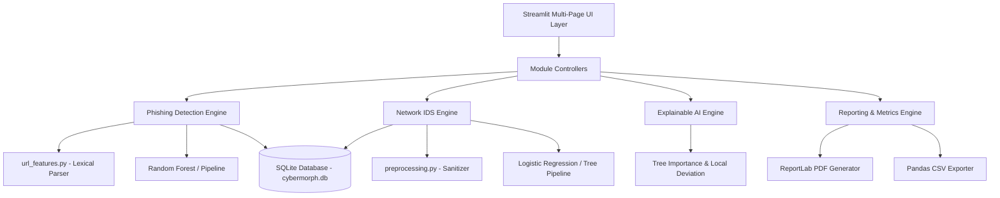

# CyberMorph AI — System Architecture & Design Documentation

## 1. System Overview

**CyberMorph AI** is an explainable machine learning-powered cyber threat analytics and defense platform. It is engineered to bridge the gap between opaque artificial intelligence models and human security analysts by combining high-precision threat classification with local interpretability and auditability.

The application addresses two critical threat surfaces:
1. **Phishing Website Ingestion:** Lexical parsing of untrusted URLs without remote code execution, mapped to the benchmark 30-feature UCI Phishing standard.
2. **Network Intrusion Detection System (NIDS):** Flow-based packet telemetry classification based on the CIC-IDS2017 flow benchmark.

---

## 2. Architectural Blueprint

The architecture is organized into four interconnected layers:

---

## 3. Layer Breakdown

### Layer 1: Presentation (Streamlit Multi-Page Dashboard)
- `app.py`: Security Operations Center (SOC) home dashboard displaying aggregated KPIs, live model states, and recent activity.
- `pages/1_Phishing_Detection.py`: Single URL analysis and academic UCI feature vector tester.
- `pages/2_Network_Intrusion.py`: Batch network flow CSV upload, schema validator, anomaly breakdown, and CSV export.
- `pages/3_Explainable_AI.py`: Global feature importance bar charts and local risk signal attribution.
- `pages/4_Model_Evaluation.py`: Held-out test set metrics, confusion matrices, and multi-algorithm comparison.
- `pages/5_Analysis_History.py`: Searchable, filterable audit trail with individual record deletion and full purge confirmation.
- `pages/6_Reports.py`: On-demand ReportLab PDF compiler and CSV exports.
- `pages/7_About_Project.py`: Academic specifications, citations, and viva defense guide.

### Layer 2: Machine Learning & Preprocessing Pipelines
- **Data Sanitization (`src/preprocessing.py`):**
  - Trims and standardizes column headers.
  - Converts infinite values (`+inf`, `-inf`) to NaN and imputes missing cells using column medians.
  - Validates CSV schemas against expected model signatures.
- **Phishing Feature Extraction (`src/url_features.py`):**
  - Performs passive lexical parsing according to RFC 3986.
  - Protects the host machine by strictly avoiding network connections to untrusted target domains.
  - Maps URL structure (IP hostnames, subdomains, shorteners, `@` symbol, redirection tokens) to the exact 30 UCI features.
- **Model Training & Inference (`src/phishing.py`, `src/network_ids.py`):**
  - Splits data using stratified 75/25 train/test splits.
  - Compares Logistic Regression, Decision Tree, and Random Forest.
  - Selects champion models based on test set F1-score.
  - Serializes trained pipelines using `joblib` alongside JSON metadata.

### Layer 3: Explainable AI & Metrics
- **Global Interpretability:** Extracts feature weights (Random Forest Gini importance / Logistic Regression coefficients) to reveal which attributes govern overall model decision boundaries.
- **Local Interpretability:** Contrasts an individual sample's feature vector with benign baseline norms, calculating which indicators elevated or diminished threat severity.
- **Evaluation Engine (`src/metrics.py`):** Computes Accuracy, Precision, Recall, F1-Score, and generates Plotly interactive confusion matrices.

### Layer 4: Persistence & Reporting
- **Database (`src/database.py`):** SQLite database (`data/cybermorph.db`) managing `analysis_history` and `model_runs` with parameterized queries.
- **Reporting (`src/reporting.py`):** ReportLab document compiler building publication-ready PDF audit reports.

---

## 4. Security & Defensive Design Considerations
1. **Safe Passive Ingestion:** Target URLs are treated as hostile strings. No HTTP GET/POST requests or headless browser rendering are initiated.
2. **Data Sanitization & Privacy:** Audit records redact sensitive query parameters and authentication credentials.
3. **No Fabricated Data:** Empty states reflect zero values honestly. All metrics are computed from real test partitions or database entries.
